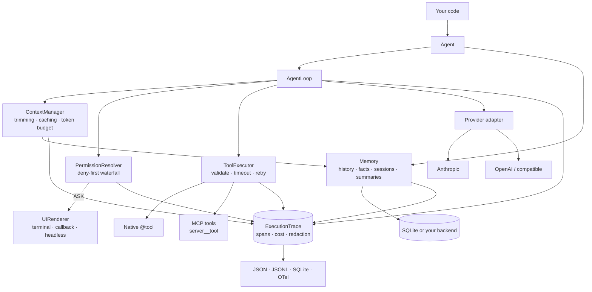

<p align="center">
  
</p>

<p align="center">
  A small, provider-agnostic Python framework for production LLM agents — a tool-calling
  loop you can read, permissions you can audit, and a trace that tells you where it broke.
</p>

<p align="center">
  <a href="https://github.com/OzgurrOzcan/Agent-Framework/actions/workflows/ci.yml">
    
  </a>
  
  
  
</p>

<p align="center">
  <a href="#quickstart">Quickstart</a> ·
  <a href="#why">Why</a> ·
  <a href="#core-concepts">Concepts</a> ·
  <a href="#api-at-a-glance">API</a> ·
  <a href="#documentation">Docs</a>
</p>

---

## Quickstart

```bash
git clone https://github.com/OzgurrOzcan/Agent-Framework.git && cd Agent-Framework
pip install -e .            # add ".[mcp]" for MCP server support
export ANTHROPIC_API_KEY=... # or OPENAI_API_KEY — whichever the model id names
```

```python
import asyncio
from agent_framework import Agent, tool, PermissionCategory

@tool(permission=PermissionCategory.AUTO)
async def search_products(query: str, max_price_usd: float | None = None) -> list[dict]:
    """Search the web for products matching a query."""
    # call your search API here
    return [
        {"name": "ThinkPad X1 Carbon", "price_usd": 1399, "url": "https://example.com/x1"},
        {"name": "MacBook Air 13",     "price_usd": 1099, "url": "https://example.com/air"},
    ]

agent = Agent(
    "claude-opus-5",                 # or "gpt-5" — the model id names its provider
    system_prompt="You help people find products. Search before you answer.",
    tools=[search_products],
)

async def main():
    result = await agent.run("Find me a lightweight laptop under $1500.")
    print(result.final_message)

asyncio.run(main())
```

The tool's schema comes from the type hints and its description from the docstring.
The agent searches, reads the results, and answers. If it loops, it stops after
`max_turns` (10 by default); add `max_budget_usd=` for a hard spending cap.

Switching provider is one line. Nothing else changes — not your tools, not your
permissions, not your traces:

```diff
- Agent("claude-opus-5", system_prompt="...", tools=[search_products])
+ Agent("gpt-5",         system_prompt="...", tools=[search_products])
```

---

## Why

- **One loop, any provider.** Anthropic, OpenAI, and any OpenAI-compatible endpoint
  (vLLM, Ollama, llama.cpp, a corporate gateway) behind one normalized message model.
- **It cannot run away.** Four independent stop layers — natural stop, `max_turns`, stall
  detection, a USD budget — and a prompt that would not fit the window is never sent.
- **Deny-first permissions.** Every tool declares one category; glob and argument-regex
  rules tighten or loosen it without touching tool code. Sub-agents can never widen a
  parent's permissions.
- **Stateless by default.** Each run starts clean. `MemoryConfig()` keeps the
  conversation; `MemoryConfig(store="app.db")` adds SQLite facts, resumable sessions and
  summaries with no database code.
- **MCP is first class.** Any stdio or HTTP server, through the same executor,
  permissions and tracing as native tools.
- **Traces, not log lines.** A redacted span tree with `where_it_failed()`,
  `tool_stats()`, `cost_summary()`, and JSON / JSONL / SQLite / OTel export.
- **Small enough to own.** Under 13,000 lines of plain Python, five runtime dependencies,
  no DSL. When the framework's assumptions stop matching yours, you edit it.

> **When not to use this.** If you want a large ecosystem of prebuilt integrations,
> retrievers and vector-store adapters, or a visual builder with hosted orchestration,
> look elsewhere. This is for teams who want a small, legible core they can debug.

---

## Providers

| Model id                                         | Provider                        | Notes                                                                                |
| ------------------------------------------------ | ------------------------------- | ------------------------------------------------------------------------------------ |
| `claude-opus-5`, `claude-sonnet-5` …             | Anthropic                       | `ANTHROPIC_API_KEY`; server-side context clearing on long runs                       |
| `gpt-5`, `gpt-4.1` …                             | OpenAI                          | `OPENAI_API_KEY`                                                                     |
| `openai:<model>` + `base_url=`                   | Any OpenAI-compatible server    | No key needed; pass `context_window=` — [details](docs/local-models.md)              |
| `openai:kimi-k3`, DeepSeek, vLLM thinking models | Endpoints that return reasoning | `reasoning_content` is round-tripped automatically — [details](docs/local-models.md) |
| `yourprovider:<model>`                           | Your own adapter                | One class, one `register_provider()` call — [guide](docs/adding-a-provider.md)       |

Bare names resolve by prefix; `provider:model` always wins; an unknown or ambiguous id
is rejected at construction, so a typo never reaches a provider.

---

## Core concepts

### Tools

`@tool` turns a plain function into a tool. The JSON Schema comes from type hints;
parameter descriptions come from `Annotated[...]` or a Google-style docstring. Sync and
async both work. Arguments are validated before your function runs, and a malformed call
becomes an error result the model can see and correct.

```python
from typing import Annotated

@tool(
    description="Look up current stock for a SKU.",
    permission=PermissionCategory.AUTO,
    timeout_seconds=10,
    idempotent=True,          # only idempotent tools are retried
    max_retries=2,
)
async def get_stock(sku: Annotated[str, "Product SKU, e.g. LAP-14"]) -> dict:
    ...
```

Oversized results are capped (head + tail) as they arrive, so one tool cannot flood the
context. Per-tool overrides: `max_result_tokens=`, `clear_old_results=False`.

### Permissions

```python
from agent_framework import PermissionConfig, DenyRule, AllowRule, TerminalRenderer

permissions = PermissionConfig(
    deny=[DenyRule(tool="shell", arg_pattern=r"rm\s+-rf")],
    allow=[AllowRule(tool="read_*")],           # glob on tool names
    on_ask=TerminalRenderer(),                  # who answers ASK prompts
)
agent = Agent("claude-opus-5", tools=[...], permissions=permissions)
```

| Category   | Behaviour                                                         |
| ---------- | ----------------------------------------------------------------- |
| `AUTO`     | Runs without asking                                               |
| `ASK`      | Prompts the renderer every time                                   |
| `ASK_ONCE` | Prompts once per unique tool + argument signature, then remembers |
| `DENY`     | Never runs; the model gets structured feedback explaining why     |

Deny rules are evaluated before allow rules. The renderer is pluggable: terminal,
callback (web UI), or headless (CI). The `ask_user` tool lets the agent ask you mid-run.

### MCP

```python
from agent_framework import Agent, ExecutionTrace, MCPServerRegistry, MCPConnectionConfig

trace = ExecutionTrace()
registry = MCPServerRegistry(trace=trace).add(
    "fs",
    MCPConnectionConfig(
        transport="stdio",
        command=["npx", "-y", "@modelcontextprotocol/server-filesystem", "/data"],
    ),
)

agent = await Agent.connect("claude-opus-5", mcp=registry, trace=trace)
try:
    result = await agent.run("Summarise the newest file in /data.")
finally:
    await registry.close_all()                  # connections are yours to close
```

Tools arrive namespaced (`fs__read_text_file`). `Agent.connect(...)` discovers eagerly
and raises `MCPDiscoveryError` if any server fails, which is what a service wants at
boot. `Agent(..., mcp=registry)` defers discovery to the first run and records a broken
server in the trace instead.

### Memory

Memory is off until you ask for it. There are three levels, and each adds to the one before.

| Level        | Turn it on                             | What it keeps                   | Where       |
| ------------ | -------------------------------------- | ------------------------------- | ----------- |
| Stateless    | default                                | nothing; every run starts empty | —           |
| Conversation | `memory=MemoryConfig()`                | earlier runs of this agent      | RAM         |
| Long-term    | `memory=MemoryConfig(store="app.db")`  | facts, sessions and summaries   | SQLite file |

**Conversation memory** carries the chat from one run to the next.

```python
chat = Agent("claude-opus-5", memory=MemoryConfig())
await chat.run("My name is Ada.")
await chat.run("What is my name?")      # "Ada"
```

When the prompt outgrows the context limit, the oldest turns are trimmed. Trimming makes
no LLM call and keeps the provider's prompt cache warm.

**Long-term memory** survives restarts. `namespace` says whose memory it is;
`session_id` says which conversation.

```python
agent = Agent(
    "claude-opus-5",
    memory=MemoryConfig(store="support.db", namespace="customer-42"),
    session_id="ticket-4412",
)
```

It keeps three separate things:

- **Facts.** Short notes stored by key. A fact reaches the model when a message shares
  words with it.
  ```python
  await agent.memory.remember("plan", "Pro, renews on 1 March")
  ```
- **Sessions.** The conversation is saved after every run. A new agent with the same
  `session_id` continues it, in this process or another.
- **Summaries.** Older turns are summarized, and every new conversation in the
  namespace starts with that summary.

`run(prompt, dry_run=True)` shows exactly what would be sent, without calling the model.
→ [Context and memory](docs/context-and-memory.md)

### Observability

```python
from agent_framework.tracing import TraceReporter, SQLiteExporter

trace = agent.get_trace()
print(TraceReporter.summarize(trace).to_text())   # human-readable run summary
print(trace.cost_summary())                       # tokens + USD, per model
print(trace.where_it_failed())                    # the failing span chain
SQLiteExporter("traces.db").export(trace)         # or JSON / JSONL / OTel

trace.subscribe(lambda event: print(event.name)) # the one hook a live UI needs
```

Every subsystem writes spans; values are redacted before storage. The `session` span
records how the agent was built, every `llm_call` records what was sent, and
`where_it_failed()` returns the chain down to the cause.
→ [Observability](docs/observability.md)

### Structured output and streaming

```python
from pydantic import BaseModel

class Invoice(BaseModel):
    number: str
    total: float

invoice = await agent.to_json("Extract the invoice.", schema=Invoice)
```

Uses each provider's native structured-output mode, re-validates client-side, and never
touches the conversation history.

```python
from agent_framework.providers.base import StreamChunkType

async for chunk in agent.run_stream("Explain the plan."):
    if chunk.type is StreamChunkType.TEXT_DELTA:
        print(chunk.payload["text"], end="", flush=True)
```

Tools execute mid-stream under the same permission engine as `run()`.

---

## API at a glance

```python
# construction — a model id or an AgentConfig, plus overrides
agent = Agent("claude-opus-5", system_prompt=..., max_turns=..., max_budget_usd=...,
              temperature=..., api_key=..., base_url=..., context_window=...,
              memory=MemoryConfig(...), tools=[...], permissions=..., session_id=...,
              mcp=registry, context_filter=..., memory_backend=..., trace=..., pricing=...,
              parent_permissions=...)
agent = await Agent.connect(config, mcp=registry, tools=[...])   # discover MCP (and load
                                                                 # a saved session) now

# four verbs — all async
result = await agent.run(prompt, max_turns=..., max_tool_rounds=..., tool_choice=...,
                         dry_run=False)
result = await agent.complete(prompt)                  # one call; tools advertised, NOT executed
async for chunk in agent.run_stream(prompt): ...
obj    = await agent.to_json(prompt, schema=PydanticModel)   # or a jsonschema dict

# result
result.final_message   # str
result.stop_reason     # StopReason
result.state.turn      # int
result.tool_calls      # list[ToolCallRequest] — mainly for complete()
result.error           # Exception | None — run() never raises for operational failures
result.context         # ContextReport — what the last call was sent

# inspection and memory
agent.get_history() · await agent.clear_history() · agent.get_trace()
agent.tools · agent.memory · agent.permissions · agent.cost · agent.session_id
await agent.memory.remember(key, value) · await agent.memory.forget(key)
await agent.memory.summarize() · await agent.memory.summarize_idle()
await agent.memory.sessions() · await agent.memory.delete_session(id)
await agent.memory.prune_sessions(idle_for=...) · await agent.memory.close()
agent.checkpoint() · agent.restore(cid)
```

`max_tool_rounds=1` gives the classic "one round of tools, then synthesise" pattern.
`tool_choice` constrains only the first model call.

---

## Architecture



Everything above the provider adapter is provider-independent. Adding a provider means
implementing one class and registering one `ProviderSpec`.
→ [Adding a provider](docs/adding-a-provider.md)

---

## Documentation

| Page                                                 | What it covers                                                                    |
| ---------------------------------------------------- | --------------------------------------------------------------------------------- |
| [Configuration](docs/configuration.md)               | `AgentConfig`, overrides, `from_env()`, API keys, what `run()` returns on failure |
| [Context and memory](docs/context-and-memory.md)     | Trimming, long-term memory, sessions, summaries, `context_filter`, checkpoints    |
| [Local and self-hosted models](docs/local-models.md) | `base_url`, context windows, response share, Kimi and `reasoning_content`         |
| [Observability](docs/observability.md)               | Span types, what each span records, exporters, live subscription                  |
| [Adding a provider](docs/adding-a-provider.md)       | The adapter contract and `register_provider()`                                    |

---

## Development

```bash
pip install -e ".[dev,mcp]"
pytest agent_framework/tests/ -q      # fully offline against mocked providers; no key needed
ruff check agent_framework/
```

`0.1.0` — the core is stable, covered by an offline suite including golden-request tests
that pin both providers' wire formats. CI runs lint and the full suite on Python 3.11
and 3.12. The public API is small on purpose. Contributions are welcome, especially new
provider adapters. Breaking changes are listed in the [changelog](CHANGELOG.md).

## License

MIT — see [LICENSE](LICENSE).
