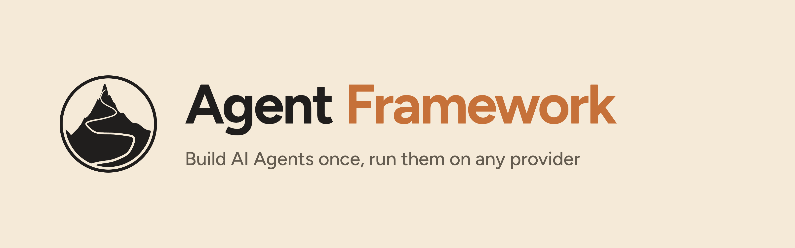
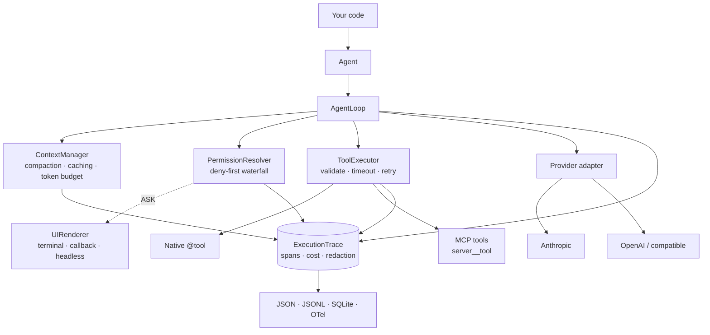

<p align="center">
  
</p>

<p align="center">
  A provider-agnostic Python framework for production LLM agents — with a tool-calling
  loop you can read, permissions you can audit, and a trace that tells you where it broke.
</p>

<p align="center">
  <a href="https://github.com/OzgurrOzcan/Agent-Framework/actions/workflows/ci.yml">
    
  </a>
  
  
  
  
</p>

<p align="center">
  <a href="#quickstart">Quickstart</a> ·
  <a href="#what-you-get">Features</a> ·
  <a href="#why-not-langchain-or-crewai">Why not LangChain?</a> ·
  <a href="#api-surface">API</a>
</p>

---

## The problem

You write your tool schemas against one provider's wire format, wire up MCP, handle its
streaming events, and ship. Then a cheaper model lands somewhere else — or a client
demands their own vendor, or a local model has to sit behind an OpenAI-compatible
endpoint. Now you rewrite the schemas, the message normalization, the tool-call plumbing
and the streaming handler. New providers keep arriving, so this is not a one-time tax —
it is a tax on every agent you build.

And the parts that actually decide whether an agent is *production-ready* are the ones
nobody wants to write twice: what stops a runaway loop, which tool may touch what, what
the last run cost, and — when it breaks at 3am — which turn it broke on.

**Agent Framework** owns exactly those parts, in ~8,000 lines of plain Python you can
read in an afternoon. Switching provider is one line:

```diff
- Agent("claude-opus-5", system_prompt="...", tools=[add])
+ Agent("gpt-5",         system_prompt="...", tools=[add])
```

The model id names its own provider, so there is no provider argument to change.
Nothing else changes either — not your tools, not your permissions, not your traces.

---

## What you get

| | |
|---|---|
| **One loop, any provider** | Anthropic and OpenAI adapters behind a normalized message model. Golden tests pin both wire formats. |
| **Local models, same code** | vLLM, llama.cpp, Ollama or any OpenAI-compatible endpoint via `base_url` — no API key, and every tool, permission and trace behaves identically. |
| **Four verbs, not forty** | `run()`, `complete()`, `run_stream()`, `to_json()`. Run shape comes from parameters, not from a new class per pattern. |
| **Can't run away** | Four independent stop layers: natural · `max_turns` · stall detection · USD budget guard. |
| **Deny-first permissions** | Four categories per tool, overridable by glob and argument-regex rules without touching tool code. Sub-agents can never widen a parent's permissions. |
| **Human in the loop** | `ASK` tools route to a pluggable renderer — terminal, callback (web UI), or headless (CI) — and `ask_user` lets the agent ask mid-run. |
| **MCP, first class** | Any stdio or HTTP server in three lines. Tools are namespaced `server__tool` and pass through the same executor, permissions and tracing as native ones. |
| **Context that holds** | Token budgeting, tool-result truncation, sliding window, LLM compaction with a persistent summary, Anthropic prompt caching. |
| **Traces, not log lines** | A span tree with automatic secret redaction: `where_it_failed()`, `tool_stats()`, `cost_summary()`, and JSON / JSONL / SQLite / OTel export. |
| **Real cost tracking** | Per-model pricing including cache-read and cache-write tiers, wired straight into the budget guard. |
| **Safe by construction** | Arguments validated against the schema before your function runs. Per-tool timeouts, retries only for `idempotent` tools, and the `tool_use ↔ tool_result` invariant preserved even on cancellation. |

---

## Why not LangChain or CrewAI?

Those frameworks are excellent for getting to a demo quickly, and for a prototype they
are often the right call. The trouble starts when the prototype has to run in
production and something goes wrong — because in production, something always goes wrong.

**1. Abstractions you can't see through.** [Octomind ran LangChain in production for
over a year before removing it](https://octomind.dev/blog/why-we-no-longer-use-langchain-for-building-our-ai-agents):
as requirements got more sophisticated they had to reach into LangChain's internals to
change low-level behaviour, and because the framework deliberately abstracts those
details away, that was often not possible. The pattern is
[well documented](https://www.mindstudio.ai/blog/llm-frameworks-replaced-by-agent-sdks) —
an error thrown three levels deep in a chain tells you almost nothing about the real
failure, and it is hard to see what was even sent to the model. LCEL's pipe operator
routes execution through internal `invoke()` machinery with no natural place to insert
logging, so engineers end up
[adding print statements inside framework source](https://logic.inc/resources/langchain-production-issues)
just to follow execution.

**2. Multi-agent opacity.** [CrewAI offers no native way](https://atlan.com/know/ai-agent/what-is-crewai/)
to isolate whether a failure came from the model, the prompt, or the data an agent read.
When a three-agent crew produces wrong output you need to know which agent deviated,
which tool call returned unexpected data, and how many tokens each step consumed — and
the open-source version gives limited built-in observability, so teams fall back to
print statements and third-party tools.

**3. Cost you find out about later.** Each agent in a crew makes its own model calls.
Practitioners report hierarchical crews making 50–100+ calls for a single task, with
bills 5–10× a single-agent approach — and default logging too noisy to diagnose it.

**4. Abstractions age badly in a field this young.** New concepts land monthly, which
makes it genuinely hard to design abstractions that survive. The cost shows up as
[API churn](https://www.upgrad.com/blog/why-are-developers-quitting-langchain/): minor
version bumps breaking production, and a package split across `langchain`,
`langchain-core`, `langchain-community` and per-integration packages that turns
migrations into projects.

### What this framework does instead

| | LangChain / CrewAI | Agent Framework |
|---|---|---|
| **Debuggability** | Errors surface deep inside framework internals | Span tree with turn, tool, args, tokens, cost, and `where_it_failed()` |
| **Cost visibility** | Bolt-on, usually a third-party service | Built in — per model, per turn, and a hard USD budget guard |
| **Runaway protection** | Mostly your problem | Four independent termination layers |
| **Provider switching** | Integration package per provider | One string — the model id names its provider |
| **Dependency weight** | Large transitive tree | 5 runtime deps: `anthropic`, `openai`, `rich`, `jsonschema`, `pydantic` |
| **Reading the source** | Large, layered, DSL-heavy | ~8,000 lines of plain Python. No DSL, no pipe operator, no magic |

**And it is yours to change.** This is MIT-licensed and small enough to actually read in
an afternoon. Clone it, add the provider your client insists on, swap the permission
engine for your company's policy service, replace the compaction strategy, teach the
cost tracker your negotiated rates. There is no plugin API to learn and no abstraction
to fight — the extension point is the source code, and it is written to be read. When
your requirements stop matching the framework's assumptions, you edit the framework
instead of working around it.

> **When you probably shouldn't use this.** If you want a large ecosystem of prebuilt
> integrations, retrievers, and vector-store adapters, LangChain has years of head start
> and this project does not compete there. If you need a visual builder or hosted
> orchestration, look elsewhere. This is for teams who want a small, legible core they
> own and can debug.

---

## Install

```bash
pip install -e ".[dev]"      # framework + test tooling
pip install -e ".[mcp]"      # optional: MCP server support
```

Requires Python 3.11+. API keys are read from the environment variable the model's
provider declares (`ANTHROPIC_API_KEY` / `OPENAI_API_KEY`), or passed explicitly via
`Agent(..., api_key=...)`.

```bash
pytest agent_framework/tests/ -q      # 437 tests, fully offline against mocked providers
```

No key is required to run the test suite.

---

## Quickstart

```python
import asyncio
from agent_framework import Agent, tool, PermissionCategory

@tool(description="Add two numbers", permission=PermissionCategory.AUTO)
async def add(a: int, b: int) -> int:
    return a + b

async def main():
    agent = Agent(
        "claude-opus-5",                 # or "gpt-5"; the id names its provider
        system_prompt="You are a helpful assistant.",
        max_turns=6,
        max_budget_usd=0.50,             # hard stop, enforced by the loop
        tools=[add],
    )

    result = await agent.run("What is 2 + 3?")
    print(result.final_message)
    print(agent.cost.snapshot())         # (usd, TokenUsage)

asyncio.run(main())
```

The model id is the only thing you must supply. `Agent(...)` takes the handful of
settings you actually reach for; everything else lives on `AgentConfig`, which is
frozen, validated at construction, and serializable:

```python
from agent_framework import Agent, AgentConfig, CompactionConfig

config = AgentConfig(
    model="claude-opus-5",
    system_prompt="You are a helpful assistant.",
    compaction=CompactionConfig(trigger_ratio=0.85),
    request_extra={"thinking": {"type": "adaptive"}},
)

agent      = Agent(config, tools=[add])
summariser = Agent(config, system_prompt="Summarise.", max_turns=2)   # override, no mutation
```

An override is applied with `dataclasses.replace`, so the config you passed is never
mutated and one config can seed a whole family of agents. An unknown model id is
rejected at construction with the fix in the message, so a typo can never reach a
provider.

Config can also come from the environment, for the same image deployed with different
settings per stage — `AGENT_MODEL`, `AGENT_MAX_TURNS`, `AGENT_MAX_BUDGET_USD` and the
other flat fields, all validated on the way in:

```python
agent = Agent(AgentConfig.from_env())            # or from_env(prefix="MYAPP_")
```

`run()` never raises for operational failures. A budget stop, a turn-limit stop, or a
provider error comes back as `result.stop_reason == StopReason.ERROR` with the exception
on `result.error`. Only `asyncio.CancelledError` propagates.

---

## Core concepts

### Tools

`@tool` turns a plain function into a tool. The JSON Schema is generated from type
hints; parameter descriptions come from `Annotated[...]` metadata or a Google-style
docstring `Args:` section. Sync and async functions both work — sync tools are run in a
thread automatically.

```python
from typing import Annotated

@tool(
    description="Look up current stock for a SKU.",
    permission=PermissionCategory.AUTO,
    timeout_seconds=10,
    idempotent=True,          # only idempotent tools are retried
    max_retries=2,
    tags=("catalog",),
)
async def get_stock(sku: Annotated[str, "Product SKU, e.g. LAP-14"]) -> dict:
    ...
```

Arguments are validated against that schema before your function runs. A malformed call
becomes an error `ToolResult` the model can see and correct — it never reaches your code.

### Permissions

Every tool has exactly one category. Rules layer on top of it in a strict deny-first
waterfall, so you can tighten a third-party or MCP tool without editing it.

```python
from agent_framework import PermissionConfig, DenyRule, AllowRule, TerminalRenderer

permissions = PermissionConfig(
    deny=[DenyRule(tool="shell", arg_pattern=r"rm\s+-rf")],
    allow=[AllowRule(tool="read_*")],           # glob on tool names
    on_ask=TerminalRenderer(),                  # who answers ASK prompts
)

agent = Agent("claude-opus-5", tools=[...], permissions=permissions)
```

| Category | Behaviour |
|---|---|
| `AUTO` | Runs without asking |
| `ASK` | Prompts the renderer every time |
| `ASK_ONCE` | Prompts once per unique tool + argument signature, then remembers |
| `DENY` | Never runs; the model gets structured feedback explaining why |

Sub-agents pass `parent_permissions=` and are rejected at construction if they try to
remove a deny rule or introduce an allow rule the parent doesn't have.

### MCP

```python
from agent_framework import (
    Agent, ExecutionTrace, MCPServerRegistry, MCPConnectionConfig,
)

trace = ExecutionTrace()
registry = MCPServerRegistry(trace=trace).add(
    "fs",
    MCPConnectionConfig(
        transport="stdio",
        command=["npx", "-y", "@modelcontextprotocol/server-filesystem", "/data"],
    ),
)

agent = await Agent.connect("claude-opus-5", mcp=registry, trace=trace)
try:
    result = await agent.run("Summarise the newest file in /data.")
finally:
    await registry.close_all()                          # connections are yours to close
```

Tools arrive namespaced (`fs__read_text_file`), so two servers exposing the same tool
name never collide.

Decide where discovery happens. `await Agent.connect(...)` connects and discovers now,
and strictly: if any server cannot be reached or listed it raises `MCPDiscoveryError`
naming every one that failed, so a misconfigured deployment crashes at start-up instead of
booting green and serving a silently reduced toolset. `Agent(..., mcp=...)` defers
discovery to the first run instead — convenient in a script or notebook — and there a
failing server is recorded in the trace and skipped, because errors inside a run are
feedback, never exceptions; `agent.tools` is incomplete until that first run. Always pass
a `trace` to the registry, either way: it is where skipped servers are reported.

### Local and self-hosted models

Any server that speaks the OpenAI wire format is a first-class target: vLLM, llama.cpp's
`llama-server`, Ollama's `/v1` endpoint, LM Studio, or a corporate gateway. Name the
adapter explicitly and point `base_url` at it — the `openai:` prefix selects the wire
format, not the vendor.

```python
agent = Agent(
    "openai:llama-3.3-70b",                  # adapter := openai; "llama-3.3-70b" hits the wire
    base_url="http://localhost:8000/v1",
    context_window=32_768,                   # your server's real window — see below
    system_prompt="You are a helpful assistant.",
    tools=[add],
)
```

No API key is needed. A custom `base_url` makes the credential optional, because a local
runtime accepts any token and the vendor's key would be the wrong one anyway; an explicit
`api_key=` or the provider's environment variable still wins, so an authenticating gateway
works unchanged.

Everything above the adapter is untouched by the switch: the tool loop, permissions,
`ask_user`, MCP servers, context compaction, checkpoints and the trace all behave exactly
as they do against a vendor API.

**Three things differ, and the framework tells you about two of them.**

*Set `context_window` yourself.* The catalog knows the windows of models it ships with;
yours it cannot. Left unset, the model inherits the provider's 200k fallback — and a model
actually served with an 8k window would then never trigger compaction and simply overflow
at the endpoint. Constructing an uncatalogued model without a window warns, naming the fix.

*Small windows need smaller buffers.* The defaults reserve 8192 tokens for the response
and 4096 to run compaction, which does not fit an 8k window; construction fails with that
arithmetic spelled out. Tighten them together:

```python
from agent_framework import Agent, AgentConfig

agent = Agent(AgentConfig(
    model="openai:qwen2.5-7b-instruct",
    base_url="http://localhost:8000/v1",
    context_window=8192,
    response_buffer_tokens=1024,
    compaction_buffer_tokens=512,
))
```

*Cost tracking is inert.* An unpriced model records `$0.00`, which for local inference is
honest, but it also means `max_budget_usd` enforces nothing — bound those runs with
`max_turns` instead, or register your own cost-per-token in the `PricingTable` if you
account for GPU time. The session span records `pricing_resolved: false` so a trace never
lies about which guard was armed.

Two compatibility notes. Requests carry `max_completion_tokens`, the current Chat
Completions field. A server that only understands the older `max_tokens` either rejects
the request or ignores the field, and then applies no response cap at all;
`request_extra={"max_tokens": 1024}` adds the older field alongside, which covers servers
that ignore unknown fields but not ones that reject them. And `to_json()` uses the
provider's native structured-output mode, which self-hosted runtimes support to varying
degrees — `request_extra` does not apply to it, so on a runtime without that support use
`complete()` and parse the text yourself.

### Observability

Tracing is not an add-on — the loop, executor, permission resolver, and context manager
all write spans. Values are redacted before they are stored, so keys and tokens don't
leak into your trace store.

```python
from agent_framework.tracing import TraceReporter, SQLiteExporter

result = await agent.run("...")
trace = agent.get_trace()

print(TraceReporter.summarize(trace).to_text())   # human-readable run summary
print(trace.cost_summary())                       # tokens + USD, per model
print(trace.tool_stats())                         # calls, errors, per tool
print(trace.where_it_failed())                    # the failing span chain

SQLiteExporter("traces.db").export(trace)         # or JSON / JSONL / OTel
```

Span types: `session`, `run`, `turn`, `llm_call`, `tool_call`, `tool_result`,
`permission_verdict`, `interrupt`, `compaction`, `memory_read`, `memory_write`,
`loop_guard`, `error`.

The trace explains its own behaviour, because settings are recorded alongside the spans
they caused. `session` carries the config the agent was built with — the *resolved*
context window, the compaction thresholds, the sampling parameters, and whether the
model was priced at all (an unpriced model records `$0.00` and silently disables
`max_budget_usd`, which is otherwise indistinguishable from a genuinely cheap run).
`run` carries the effective policy of one run, since `run(max_turns=3)` overrides the
config per call: without it, a trace cannot separate "the caller capped this run" from
"the deployed config changed", nor tell a `max_tool_rounds` cap or `complete()` apart
from a permission wall — all three look like `tool_use` with no `tool_call` span.

Like every other span, `session` records settings, not content: the system prompt is
fingerprinted rather than copied (enough to tell whether two runs used the same prompt),
and `base_url` is stripped of userinfo and query strings, where credentials hide.

`where_it_failed()` returns the chain from the root down to the *cause* — for a run
stopped by its turn limit, `[run, loop_guard:max_turns]` — skipping spans that failed only
because a child did. Cancelling a run, or closing its stream early, marks its spans
`cancelled` rather than `error`, and the agent stays usable.

For a live UI, subscribe once — that single hook is all a renderer needs:

```python
unsubscribe = trace.subscribe(lambda event: print(event.name, event.duration_ms))
```

### Structured output

```python
from pydantic import BaseModel

class Invoice(BaseModel):
    number: str
    total: float

invoice = await agent.to_json("Extract the invoice.", schema=Invoice)
```

Uses each provider's native mechanism (Anthropic `output_config.format`, OpenAI strict
`json_schema`), with a prompt-based fallback for adapters that don't override it. The
result is re-validated client-side against your original schema — including constraints
provider-side decoders can't enforce — and the call **never touches the agent's
conversation history**.

### Streaming

```python
from agent_framework.providers.base import StreamChunkType

async for chunk in agent.run_stream("Explain the plan."):
    if chunk.type is StreamChunkType.TEXT_DELTA:
        print(chunk.payload["text"], end="", flush=True)
```

Chunk types: `text_delta`, `tool_use_start`, `tool_use_delta`, `tool_use_complete`,
`reasoning_delta`, `usage`, `stop`, `error`. Tools execute mid-stream under the same
permission engine as `run()`.

### Memory and checkpoints

Short-term memory is the working message buffer. Long-term memory is optional, backed by
SQLite or in-memory, and surfaces matching facts into a `<relevant_context>` block during
context assembly.

```python
cid = agent.checkpoint()          # full fidelity: tool calls, results, reasoning, cost
await agent.run("try something risky")
agent.restore(cid)                # exact rollback
```

---

## API surface

```python
# construction — a model id or an AgentConfig, plus overrides
agent = Agent("claude-opus-5", system_prompt=..., max_turns=..., max_budget_usd=...,
              temperature=..., api_key=..., base_url=..., context_window=...,
              tools=[...], permissions=..., memory=..., trace=..., pricing=...)
agent = await Agent.connect(config, mcp=registry, tools=[...])   # discover MCP eagerly

# four verbs — all async
result = await agent.run(prompt, max_turns=..., max_tool_rounds=..., tool_choice=...)
result = await agent.complete(prompt)                  # one call; tools advertised, NOT executed
async for chunk in agent.run_stream(prompt): ...
obj    = await agent.to_json(prompt, schema=PydanticModel)   # or a jsonschema dict

# result
result.final_message   # str
result.stop_reason     # StopReason
result.state.turn      # int
result.tool_calls      # list[ToolCallRequest] — mainly for complete()
result.error           # Exception | None

# inspection
agent.get_history() · agent.clear_history() · agent.get_trace()
agent.tools · agent.memory · agent.permissions · agent.cost
agent.checkpoint() · agent.restore(cid)
```

`max_tool_rounds=1` gives the classic "one round of tools, then synthesise" pattern.
`tool_choice` constrains only the first model call; later turns fall back to auto.

---

## Architecture



Everything above the adapter boundary is provider-independent. Adding a provider means
implementing one class — `call()`, `stream()`, `denormalize_messages()`, `tool_schema()`,
and optionally `structured()` — and registering one record:

```python
from agent_framework import ProviderSpec, register_provider

register_provider(ProviderSpec(
    name="bedrock",
    env_key="BEDROCK_API_KEY",
    model_prefixes=("bedrock.",),          # so "bedrock.foo-1" resolves without a prefix
    build=lambda **kw: MyBedrockAdapter(**kw),
    context_windows=(("bedrock.", 200_000),),
))

agent = Agent("bedrock:anthropic.claude-opus-5")
```

That one record is the single source of truth for the adapter, the API-key variable, the
model names the provider owns, and its context windows — there is no enum to extend and
nothing else in the framework to touch.

---

## Project status

`0.1.0` — the core is stable and covered by **437 tests** that run fully offline, including
golden-request tests that pin both providers' wire formats. CI runs lint and the full
suite on Python 3.11 and 3.12.

The public API is small on purpose and intended to stay that way. Contributions are
welcome — especially new provider adapters, since that is the whole point.

## License

MIT — see [LICENSE](LICENSE).
